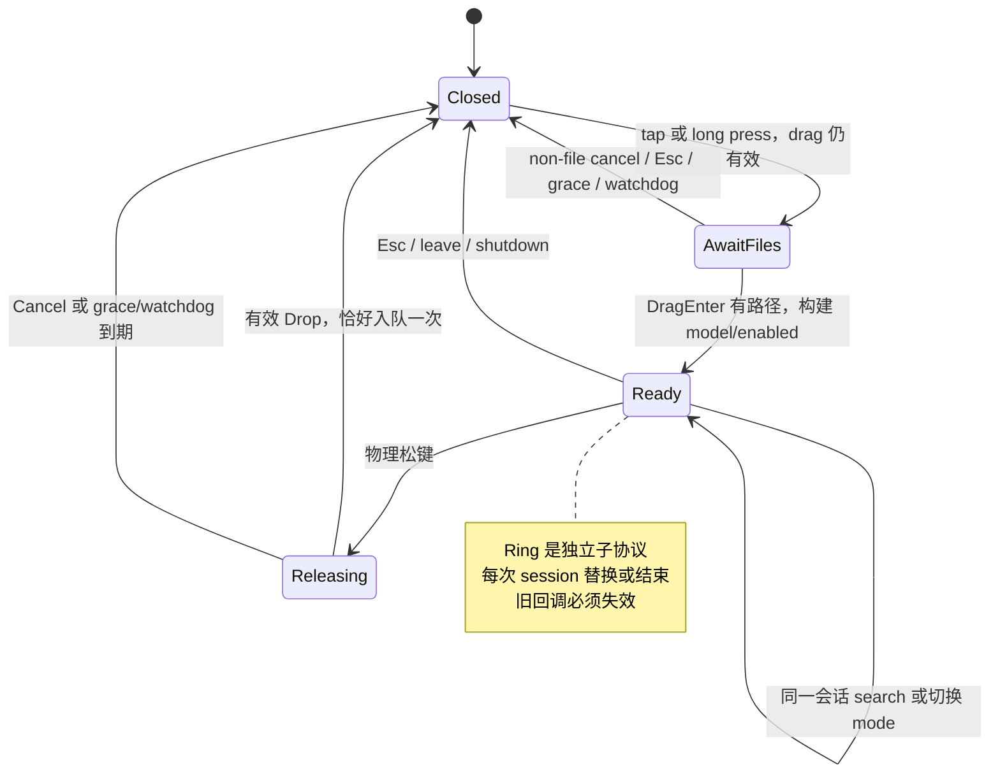
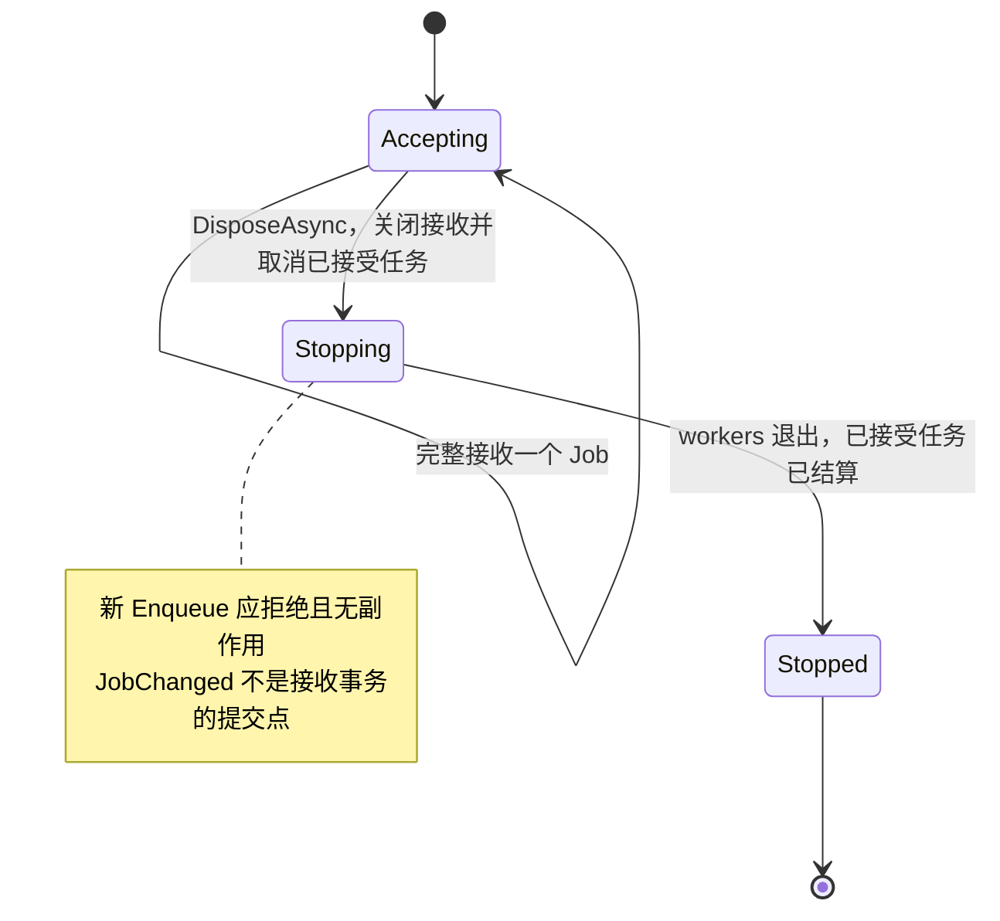
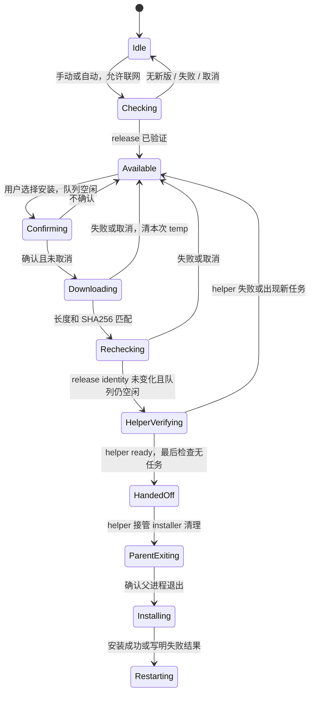

# 隐式状态机盘点与演进决策

审计日期为 2026-11-09，源码基点为 `2b1bcb5`。下方盘点表保留发现问题时的代码和测试证据。

本次对 `src/` 的 **141 个 C# 文件和 1 个安装更新脚本**做全仓检索，对候选的字段、回调、异步挂起点、定时器、集合成员关系和资源生命周期逐项追踪。共整理 **45 组运行／交互协议和 13 组局部解析／输出协议**。其中也列入已经显式或部分显式的协议作对照，不能把 58 组都当作待重构问题。

判定标准：同一个输入的处理依赖此前事件，且存在合法／非法的事件顺序或资源所有权交接。普通配置值、不可变数据、累计计数、无历史依赖的 `switch` 和编译器生成的 `async`／`yield` 机制不单独计数。嵌套字段和列表语法属于带栈协议，不强行压成有限状态枚举。一个表项可能包含彼此配合的子协议；数量是建模粒度，不是缺陷数量。

优先明确会话身份、操作归属和关闭边界。保留已封装好的局部状态机。

## 0.1.7 修复

- F1、F4：队列关闭和接收使用同一把锁。已接收任务按通道顺序结算。任务通知先于执行，单个订阅者抛异常时，其他订阅者和任务仍能继续。
- F2：轮盘和 OLE 宿主共享会话身份。异步模型发布、悬停和计时器验证所属会话，Drop 使用命中时的模型与设置。
- F3：关闭、隐藏或清空 Dock 会使在途读入失效。旧结果只完成拖放的 deferral。
- F5：同名询问和文件夹选择在原生窗口创建后绑定取消。用户主动关窗仍返回跳过或空选择。
- F6：更新助手验证完安装包后等待应用授权。应用确认队列空闲后授权并退出，助手随后才安装。
- F7：撤销执行期间保留原有顺序。失败恢复该条目的可撤销状态，仍可按完成顺序查询 `Latest`。

## 先处理什么

证据级别：**复现**表示在本次 macOS 环境对实际 Core 实现执行了隔离探针；**静态**表示源码可构造该事件顺序，但尚未在 Windows 桌面实测。风险优先级和重构收益分开判断。

| 项目 | 证据与具体结果 | UX／DX／AX 的影响 | 决策 |
| --- | --- | --- | --- |
| F1：队列关闭后的入队不是原子的 | **复现**：[Enqueue](../src/DropHalo.Core/Jobs/JobQueue.cs#L56) 先加入 `_jobs`、递增 `_outstanding`、建立取消源、发事件，最后才发现 Channel 已关闭。`DisposeAsync → Enqueue` 抛出 `ObjectDisposedException` 后仍留下一个 `Pending`，`WhenIdleAsync().IsCompleted == false` | 关闭边界可能留下假任务；调用者和代理收到拒绝，却无法根据失败推断没有副作用 | **优先修复**。先判定接收状态，再原子提交入队；关闭与入队使用同一同步约束 |
| F2：旧轮盘回调可能作用到新会话或恢复已关闭的 host | **静态**：[OnEntered](../src/DropHalo.App/WheelController.cs#L173) 读取旧 session 后，[Rebuild](../src/DropHalo.App/WheelController.cs#L477) 无当前会话校验地调用 `host.Show`；[Close](../src/DropHalo.App/WheelController.cs#L346) 可在 UI 线程同时清空会话并 `Hide`。`OnCanceled`／`OnHovered`／`OnTyped` 排队的动作也没有绑定原会话身份 | 可能误关新轮盘、误应用搜索／悬停，或留下覆盖屏幕的透明 host；跨线程修改难以定位和自动验证 | **优先建模并补回归**。会话身份必须贯穿 host、UI 队列和定时器；只加一个枚举不足以解决竞争 |
| F3：Dock 清空与异步读入之间没有失效约束 | **静态**：[OnDrop](../src/DropHalo.App/Dock/DockWindow.cs#L280) 挂起等待 `GetStorageItemsAsync`，之后直接向 `_files` 添加；清空按钮会清列表并隐藏窗口，却不使正在读取的操作失效 | 清空后旧文件可能重新进入内部列表；用户意图、UI 内容和异步完成结果缺少同一个提交条件 | **优先补异步交错测试**。清空／退出使旧读入失效；读入完成只提交到仍有效的内容版本 |
| F4：任务观察者异常可留下从未发布的 Pending | **复现**：[Enqueue](../src/DropHalo.Core/Jobs/JobQueue.cs#L56) 在 Channel 写入之前调用 `JobChanged`。订阅者抛异常后，列表已有任务，worker 永远收不到它 | 单个订阅者能破坏队列存活性；代理／插件更难安全订阅事件 | 与 F1 一起处理接收事务和通知顺序。明确观察者异常的处理方式，避免在持锁期间调用外部处理器 |
| F5：同名询问在“取消已注册、对话框未出现”间有窗口 | **静态**：[ConflictDialog.AskAsync](../src/DropHalo.Shell/ConflictDialog.cs#L25) 注册取消后直接 `Ask`；取消回调只枚举当时已存在的对话框。若取消发生在原生窗口创建前，回调可能什么也没关闭，随后仍弹出询问。FolderDialog 有额外的 token 检查，但检查到 Show 之间仍需原生生命周期验证 | 任务取消后仍可能留下询问，拖住 worker／退出；依赖时序的取消难以自动化 | **优先验证**。把窗口创建、取消请求和完成统一到该 STA 线程的对话框生命周期 |
| F6：更新流程把多种阶段压在 busy、nullable 和控件状态里 | **静态建模**：检查、等待确认、下载、复核、helper 验证都使用 `_updateBusy`；可用 release、取消源、目录的清理所有权和按钮是否可取消分散在 [SettingsWindow.Updates](../src/DropHalo.App/Settings/SettingsWindow.Updates.cs#L23) 与 [UpdateInstaller](../src/DropHalo.App/Updates/UpdateInstaller.cs#L10) | 后续改动容易在错误阶段启用取消或删掉 helper 正在使用的包；维护者和代理需同时推理多份状态 | **高收益显式化**，但本次没有证据说明现有安装损坏。先固定交接与清理契约，再局部重构 |
| F7：撤销失败会改变 Latest 的时序含义 | **复现**：[UndoLedger.UndoAsync](../src/DropHalo.Core/Jobs/UndoLedger.cs#L47) 先 Remove，失败后 Add 到末尾。对旧任务撤销失败后，`Latest` 从较新任务变成旧任务 | 破坏“最新任务”查询的稳定含义；当前运行代码没有调用 `Latest`，所以不冒充正在发生的用户故障 | **低优先级**。将 in-flight 与原顺序分离，未来启用全局撤销前补测试 |

F1、F4、F7 的探针都只使用临时文件和内存文件操作替身；不操作用户文件、不发起网络请求、不启动 Windows 安装。

## 运行与交互协议全表

“保持”意味着现有局部表示足够清楚，不需要为了统一形式新增类或枚举。“收拢”意味着下一次改动该流程时让一个模块负责转换和不变量。下列状态名是对现有行为的描述或建议命名，不代表已存在同名类型。

### 输入、OLE 与轮盘：I01–I13

| ID／协议 | 目前藏在哪里 | 状态和主要事件 | 必须保留的不变量／决定 | 现有验证入口 |
| --- | --- | --- | --- | --- |
| I01 拖拽识别 | [DragMonitor](../src/DropHalo.Shell/DragMonitor.cs#L12)：`DragPhase` + `_buttonDown` + `_downAt` + poll timer | Idle → Pressed（当前仍叫 Idle）→ MaybeDragging → Dragging；按下、超过阈值、找到 SysDragImage、松开；丢失松键时读物理键恢复 | **部分显式**。不能把 `MaybeDragging` 当无效：无 drag image 的 OLE 源仍可用修饰键。保留 8px 阈值与丢失松键恢复；补一张完整转换表即可先提升可读性 | Core 输入测试；Acceptance `HooksScenario`、`AppScenario.Wheels/Touch/Dock` |
| I02 hook 线程生命周期 | [DragMonitor.Start/Dispose/Run](../src/DropHalo.Shell/DragMonitor.cs#L77)：nullable thread、ready、hook handles、两个 native timer | NotStarted → Starting → Running → Stopping → Stopped／启动失败 | 线程退出后才释放 callbacks／handles；`Join(2000)` 是等待上限，不能当作已退出证明。**补生命周期测试**，不把 nullable thread 当全部状态 | Acceptance `HooksScenario`；Windows 专用 |
| I03 修饰键按压 | [ModifierTapper](../src/DropHalo.Core/Input/ModifierTapper.cs#L17)：`_physical/_held/_combo/_pressedAt/_pressedWhileDragging/_spent` | Released → Collecting → Consumed／Spoiled → Released；左右键、repeat、组合键、其他键、tap／hold、rebind | 一次完整按压最多触发一次；两侧同名键都释放才算逻辑 key-up；拖拽前按住不算 tap；按释放时的绑定判定。**保持封装**，先补事件序列，不拆成通用输入框架 | `ModifierTapperTests` |
| I04 Win 吞键 | [WinKeyGate](../src/DropHalo.Core/Input/WinKeyGate.cs#L14)：每个物理键的 dictionary 项及 bool | Up → PassedDown／SwallowedDown → Up；repeat、drag end、rebind | down/up 必须成对处理；拖拽结束或重绑定不能放漏 swallowed up。**保持**，每键状态天然独立 | `WinKeyGateTests` |
| I05 搜索吞键 | [TypeAhead](../src/DropHalo.Core/Input/TypeAhead.cs#L16)：`Up/Passed/Taken` byte 数组和 Listening | 每键 Up → Passed／Taken → Up；Listening 控制是否发 Typed；吞掉的 repeat 在关闭后仍按对称规则处理 | **局部已显式**。不要把低层键盘状态和搜索 query 混在一个枚举；保留快捷键排除与按键配对 | `TypeAheadTests`、`WheelSearchTests`、Acceptance `Search` |
| I06 触屏／笔长按 | [LongPress](../src/DropHalo.Core/Input/LongPress.cs#L17)：nullable anchor + spent；timer 在 DragMonitor | NoHold → Timing → Spent；移动出 slop 重新计时；非触控／禁用／drag end 失效 | 停住鼠标不触发；同一锚点只触发一次。**保持**，若修改 timer 接口，须验证旧 timer 不消费新锚点 | `LongPressTests`、Acceptance `Touch` |
| I07 边缘访问 | [EdgeDock](../src/DropHalo.Core/Input/EdgeDock.cs#L20)：nullable `_visiting` + Enabled；monitor cache 在 DragMonitor | NotAtEdge ↔ VisitingLeft／Right；drag start 选指针对侧；离开再回来才重新触发 | 显示器接缝不是开放屏幕边缘；dock 只对确认 drag image 自动打开。**保持**，不新增持久状态 | `EdgeDockTests`、Acceptance `Dock` |
| I08 host 窗口生命周期／显隐命令 | [DropTargetHost](../src/DropHalo.Shell/DropTargetHost.cs#L41)：thread、HWND、nullable placement、Show/HideMessage | NotStarted → RegisteredHidden ↔ RequestedVisible；Destroy；字段修改和原生窗口消息并非同时发生 | IsVisible 当前是“有 placement”的请求状态；覆盖层显示在 wheel 上方；Show/Hide 不重新注册 OLE。**收拢到 host 所属 STA 的会话协议**，与 I11 共同处理 F2 | Acceptance `HostScenario`、`AppScenario.Frame` |
| I09 OLE 拖入／悬停／放下 | [DropTargetHost.Target](../src/DropHalo.Shell/DropTargetHost.cs#L338)：`_inside/_paths/_hovered/_gate` | Outside → EnteredFiles／EnteredNonFiles → Over → Dropped／Left／Reset | 只允许 COPY，绝不向源报告 MOVE；Drop 重新检查允许 effect 和有效 hit；新 showing 重置 gate，同 showing 的 model 更新保留 gate。**保持本地处理器**，增加会话身份约束 | Acceptance `HostScenario`、`SourceScenario`、`Wheels/Conflict/Actions` |
| I10 误触安全门 | [SectorGate](../src/DropHalo.Core/Wheel/SectorGate.cs#L9)：单向 `IsOpen` | AwaitHub → Open；只有访问 hub 打开；新 gate 才复位 | 靠屏幕边缘打开时，不得因原地松手误转换。**保持这个两态类**，不需要再引入 state enum | `SectorGateTests`、`WheelGeometryTests` |
| I11 轮盘会话／搜索／结束宽限 | [WheelController](../src/DropHalo.App/WheelController.cs#L59)：nullable session、Paths、Model、Query、settings snapshot、idle grace/watchdog | Closed → AwaitFiles → Ready；切换 mode 替换 session；typed 更新 query；button-up 启动 300ms grace；drop/cancel/watchdog 结束 | 同一个 session 的 paths/model/enabled/settings 必须一致；Drop 恰好入队一次；旧回调不得操作新会话；保留 OLE 松键后的宽限和两次物理松键检测。**最高收益收拢项** | Core `WheelSearch/WheelBuilder/FrameCheck` 是局部验证；跨线程会话依赖 Acceptance，缺少纯会话时序测试 |
| I12 外环驻留与关闭 | [WheelController.Hover/OpenRing/CloseRing](../src/DropHalo.App/WheelController.cs#L399)：`_pendingGroup`、OpenGroup、Ring、dwell/ringClose timer | Closed → Dwelling(group) → Open(group) → Closing；回 hub 立即关闭；200ms 展开、离开 150ms 收起 | OpenGroup、Ring、host hit-test、wheel children 必须指向同一个 model；switch/close 使旧 timer 失效。**从 I11 内局部收拢**，不改变两条时限 | `WheelGeometryTests`；Acceptance `Wheels` |
| I13 轮盘渲染／动画／诊断世代 | [WheelWindow](../src/DropHalo.App/Overlay/WheelWindow.cs#L113) + [FrameWatch](../src/DropHalo.Core/Wheel/FrameCheck.cs#L145)：shown/model/ring、generation、modelFrameGeneration、backgroundRevision、checkedAt/flat | Hidden ↔ Showing／Shown → Fading → Hidden；Prewarming；等待 first/model frame；检查→复查→Drawn／Flat | 过期 fade、prewarm 和屏幕采样不能影响后来的 show；高对比保持不透明；Flat 连续确认后通知、恢复后可再通知。**复用现有 generation 做法**，把它推广到 I11，不重写动画 | `FrameCheckTests`；Acceptance `Frame/Performance/Settings` |

### Dock、任务与文件：J01–J10

| ID／协议 | 目前藏在哪里 | 状态和主要事件 | 必须保留的不变量／决定 | 现有验证入口 |
| --- | --- | --- | --- | --- |
| J01 Dock 显隐和暂存内容 | [DockWindow](../src/DropHalo.App/Dock/DockWindow.cs#L50)：AppWindow.IsVisible、files.Count、idleGrace、Quitting、wheelOpen | Hidden ↔ EmptyVisible／HoldingFiles；结束空拖延迟 500ms 隐藏；clear、close、quit | 当前工作区缓存路径及 `IStorageItem`，不复制或移动原文件；wheel 打开时不抢 drop host；普通关窗隐藏，退出才销毁。**保留显隐与内容两个正交维度** | `EdgeDockTests`；Acceptance `Dock`，已有未提交 `DockBatch` 扩展 |
| J02 Dock 异步读入 | [OnDrop](../src/DropHalo.App/Dock/DockWindow.cs#L280)：`_over/_dropping`、DataView、deferral | Hovering → ReadingStorageItems → Committed／Rejected／Failed；drag end 与 read 完成可交错 | deferral 必须完成；大小写不敏感去重；旧请求不能撤销用户的 clear／quit 意图。**先补内容版本／操作身份的测试**，见 F3 | Acceptance `Dock` 覆盖常规读入；缺少暂停 read 后 clear／quit 的确定性测试 |
| J03 Dock 拖出 | [DragsOut](../src/DropHalo.App/Dock/DockWindow.cs#L329)：每行闭包的 dragged、全窗 draggingOut、dragImage；复用缓存的 StorageItems | Idle → ValidatePresentAndPrepare（同步）→ Dragging(snapshot) → Copied／Linked／Canceled／Failed | 只提供 Copy/Link；取消保留所选文件；成功只移除本次 snapshot；失踪文件只忘路径；拒绝拖回自身。**保留并行改动去掉异步准备的方向**；per-drag 记录和全窗状态仍应有一致性约束 | Acceptance `Dock/DockBatch`；取消和批量快照应继续保留；本次未验证新的 Windows 拖出实现 |
| J04 单任务执行 | [JobState](../src/DropHalo.Core/Jobs/Job.cs#L5) + [JobQueue.RunAsync](../src/DropHalo.Core/Jobs/JobQueue.cs#L164)：enum、cancel map、outputs/undo/replaced/finishedAt | Pending → Running → Done／Failed／Canceled／Skipped；Pending 也能直接 Failed／Canceled；Done → Undone；Retry 生成新 Job | **部分显式**：不是只加枚举就完成建模。完成状态与结果、清理和 undo record 要一致；retry 不复活旧 Job；取消请求不等于已清理完成。优先局部转换方法／断言 | `JobQueueTests`、`ConflictTests`、`FileActionsTests`；Acceptance `Queue` |
| J05 队列接收、关闭与空闲 | [JobQueue](../src/DropHalo.Core/Jobs/JobQueue.cs#L56)：channel writer 完成态、cancel map、outstanding、idle TCS、workers | Accepting → Stopping → Stopped；非空→空闲；每 lane 顺序执行，两 lane 可并行 | 接受或拒绝一次 Enqueue 必须是完整事务；拒绝无列表／计数／通知副作用；关闭不接新任务；idle 只在已接受任务结算后完成。**优先修 F1/F4** | `JobQueueTests` 有双 lane／FIFO／cancel／idle；本次 probe 补出了接收失败缺口 |
| J06 撤销登记与执行 | [UndoLedger](../src/DropHalo.Core/Jobs/UndoLedger.cs#L47)：entries 成员关系、snapshot map、Remove/Add | NotRecorded → Available → InFlight → Consumed；失败回 Available | 同一个 undo 不能同时执行两次；变更过或无法核实的输出保留；失败可重试且不改变原完成顺序。**显式分离 in-flight 与登记顺序**；不必扩张公共 JobState | `JobQueueTests`、`FileActionsTests`；F7 已复现，Latest 当前无产品调用 |
| J07 输出提交／回滚事务 | [OutputFiles.PlaceAsync](../src/DropHalo.Core/Jobs/OutputFiles.cs#L137)、[Rollback](../src/DropHalo.Core/Jobs/OutputFiles.cs#L56)、[OutputSnapshot](../src/DropHalo.Core/Jobs/OutputSnapshot.cs#L1) | Planned → WritingTemp → WrittenTemp → ConflictSettled → Committed → Fingerprinted；失败→清 temp／回滚；回滚 claim 临时名→再核实→删除或归还 | 原子 rename 不覆盖竞态新文件；替换先写好新内容再回收旧项；仅回滚身份未变的本次输出；源文件不回滚删除。**保持共享事务实现**，不为每个引擎另建状态机 | `OutputFilesTests`、`OutputPlannerTests`、`ConflictTests`、`JobQueueTests` |
| J08 同名决策的作用域 | [JobConflicts](../src/DropHalo.Core/Jobs/JobConflicts.cs#L23)：nullable forTheRest、own、replaced | AskEach → RememberedPolicy；每项先判断是否 own；settle→replace→wrote | 源、源的上级目录、自己的输出不能替换；remembered policy 只属于本次 Job，retry 使用新实例。**保持**，保留取消和失败后的安全检查 | `ConflictTests`、Acceptance `Conflict` |
| J09 Shell 文件事务 | [ShellFileOperations](../src/DropHalo.Shell/ShellFileOperations.cs#L71) + [TransferAction](../src/DropHalo.Core/Actions/TransferAction.cs#L34) | 选目录→规划→冲突决策→回收替换项→提交 Shell 队列→PerformOperations→成功／部分中止／取消 | 返回 Shell 实际目的路径；取消不能谎称物理操作未发生；回收不支持时需要用户明确选择；undo 基于实际结果。**保持平台事务**，部分结果／取消需要 Windows 证据 | `FileActionsTests`；Acceptance `FileOpsScenario/Actions/Conflict` |
| J10 桌面任务交接／原生窗口 | [Desktop](../src/DropHalo.App/Desktop.cs#L17)、[ConflictDialog](../src/DropHalo.Shell/ConflictDialog.cs#L25)、[FolderDialog](../src/DropHalo.Shell/FolderDialog.cs#L24) | Scheduled → PostedToUI／STAStarting → CreatingWindow → Showing → Answered／Canceled／Faulted；剪贴板忙最多尝试 5 次；dispatcher 拒绝投递要失败完成 TCS | token 取消必须关闭同一轮窗口并结束 TCS；用户关冲突框是 Skip，用户关 folder 是 null，任务取消是 canceled Task；打开 Explorer 重命名编辑器不等于用户已完成改名。**保留线程交接与重试**，补 F5 的窗口创建竞态 | `FileActionsTests`；Acceptance `Actions/Conflict`；确定性取消交错尚缺 |

### 工具、持久化与进程：T01–T09

| ID／协议 | 目前藏在哪里 | 状态和主要事件 | 必须保留的不变量／决定 | 现有验证入口 |
| --- | --- | --- | --- | --- |
| T01 工具目录读取／重试／监听 | [UserToolCatalog](../src/DropHalo.Core/Tools/UserToolCatalog.cs#L56)：Current、ReadFailed、readRetries、watcher/debounce、Changed；App 的 nullable `_knownTools` 区分首次和后续快照 | Empty／Loaded → EditDebounce → Reading → Published／RetainedWithProblem；I/O 失败最多 3 次重试；watch/dispose；首次建立已知 id 集，后续新增才通知 | I/O 失败保留最后可用工具；无效 manifest 与暂时不可读区分；自身 `.problems.json`／tmp 不触发循环；重复 id 不相互覆盖；首次扫描不误报所有工具为刚安装。**保持失败语义**，补“已排队 callback 在 Dispose 后执行”的生命周期测试 | `UserToolCatalogTests`、`ToolCatalogFailureTests` |
| T02 排布读写与监听 | [LayoutStore](../src/DropHalo.Core/Wheel/LayoutStore.cs#L64)：stamp、Current、LoadProblem、watcher/debounce | Loaded → OutsideEditPending → Reloading → Applied／I/O retry／坏文件回退；Update 先读磁盘再变更；dispose | 编辑应用于磁盘最新版本；本次写成功后才发布 Current；读失败不当作空排布。**保持与 Catalog 不同的重试策略**，不为去重代码强行合并 watcher；补停止后的回调测试 | `Wheel/LayoutStoreTests/WatcherTests/FailureTests/LifecycleTests` |
| T03 小 JSON 读写与迁移 | [SettingsStore/JsonFile](../src/DropHalo.Core/Settings/SettingsStore.cs#L32)、[RecentItems](../src/DropHalo.Core/Wheel/RecentItems.cs#L1) | Missing → Defaults；Valid → Repair/Migrate → Current；BadJson → .bad + Defaults；Save→Temp→Flush→Rename→Publish | 写入失败不能先发布未持久化设置；I/O 失败与 JSON 格式坏不能混为一谈；migration 只在旧版本应用。**保留现有共享路径**，不把每个设置项都当 FSM | `SettingsStoreTests`、`RecentItemsTests`、`LayoutStoreFailureTests` |
| T04 用户脚本的信任有效性 | [UserToolSettings](../src/DropHalo.Core/Settings/UserToolSettings.cs#L9)、[WheelBuilder](../src/DropHalo.Core/Wheel/WheelModel.cs#L1)、[ToolToggled](../src/DropHalo.App/Settings/SettingsWindow.cs#L717) | Untrusted → Trusted(id, commandHash)；commandHash 变更→Untrusted；手动撤销→Untrusted；recipe 无需脚本信任 | 可执行命令的授权和目录读取成功是不同状态；脚本变更后的授权依据仍按现行 hash 契约处理。**保留派生判定**，不复制一份可漂移 trusted bool | `WheelSlotTests`、`ScriptToolTests`、`ToolManifestReaderTests`、Acceptance `UserTools` |
| T05 用户脚本运行 | [ScriptTool](../src/DropHalo.Core/Tools/ScriptTool.cs#L51)：每次运行的 scratch、detail、skipped、ProcessOutcome | Resolve → ExpandArgs → PerFile／Batch → Running → OutputChecked／Skipped／TimedOut／Failed → Commit → Cleanup | 实例复用，运行状态必须局限在该调用；script skip、非零退出、超时是不同结果；scratch 清理必须在进程结束后；提交复用 J07。**保持无共享运行字段的形态** | `ScriptToolTests`、`ScriptOutputTests`、Acceptance `UserTools` |
| T06 配方流水线 | [RecipeTool](../src/DropHalo.Core/Tools/RecipeTool.cs#L63)：step index、inputs、scratch、final request、UnchangedPaths | ResolveStep → RunIntermediate → FeedNext → RunFinal → PreserveEarlierWork／Commit → Cleanup；失败／取消清理 | 中间 no-op 传原输入；最终 no-op 保留前面的实际加工成果；冲突 skip 不误当 no-op；最终用 Job 的 Written/Conflicts；不运行另一个用户脚本。**保持线性控制流**，不引入通用工作流引擎 | `RecipeToolTests`、`SkillExamplesTests` |
| T07 子进程执行与管道 | [SidecarProcess](../src/DropHalo.Engines/Media/SidecarProcess.cs#L28)、[SidecarProcessRunner](../src/DropHalo.Engines/Tools/SidecarProcessRunner.cs#L1) | Start → Running + DrainingPipes → ProcessExited + PipesDrained → Complete；cancel/timeout→KillTree→WaitExit→Drain→Canceled／TimedOut | 取消请求、发送 kill、收到真实退出信号是不同阶段；调用者能清输出前必须确认进程退出；stderr tail 有界；callback 失败与取消不要混淆。**保持真实退出等待**，补异常 callback 的存活性测试再考虑变更 | `SidecarProcessRunnerTests`、`FfmpegConverterTests` |
| T08 Windows Job Object 所有权 | [KillOnCloseJob](../src/DropHalo.Engines/Tools/KillOnCloseJob.cs#L157) | Allocate → PipesReady → Suspended → AssignedToAppAndRunJobs → Resumed → Completed/PreserveChildren 或 Killing/WaitHandles → Disposed | Resume 前完成 containment；setup 失败杀掉 suspended process；结束信号晚于 accounting 变化；父 app job 保护后台子进程。**保持 SafeHandle/using**，不将复杂原生协议改成单个 running bool | `SidecarProcessRunnerTests` 的 Windows 分支；macOS 不能证明该分支 |
| T09 编码器发现缓存 | [FfmpegConverter.EncodersAsync](../src/DropHalo.Engines/Media/FfmpegConverter.cs#L185)：nullable Task + Task status | NotAsked → Querying → Ready；Faulted／Canceled → 下次调用重试；多个调用共享 Querying Task | 单个转换取消不能取消所有调用者共享的查询；失败不是永久无编码器。**保持 Task 自带状态**，无需复制一个缓存状态枚举 | `FfmpegConverterTests`、`FfmpegPlanTests` |

### 设置、更新与应用生命周期：U01–U13

| ID／协议 | 目前藏在哪里 | 状态和主要事件 | 必须保留的不变量／决定 | 现有验证入口 |
| --- | --- | --- | --- | --- |
| U01 设置草稿与保存 | [SettingsWindow](../src/DropHalo.App/Settings/SettingsWindow.cs#L103)：loading、控件值 vs Current、600ms naming timer、saveProblem | Loading → Synced ↔ Editing → Debouncing → Saved／Invalid／SaveFailed；关窗 flush 命名 | WinUI 延迟 change 不能回写未授权中间值；无效热键不存盘；失败要有可见反馈。**保持值比较**，不能只靠 loading bool；关闭、重启、安装前统一 SaveNaming 契约 | `SettingsStoreTests`、`ConflictCheckerTests`；Acceptance `Settings` |
| U02 设置里的目录选择 | [PickFolderAsync/ToFolderAsync](../src/DropHalo.App/Settings/SettingsWindow.cs#L871)：radio、已有 Folder、await picker | NextToSource → Selecting → FolderSelected／Canceled／Failed；有旧目录可直接切回 | 未选中目录不留下无效的 Folder 模式；失败应依据 Save 的结果恢复显示。**保持简单流程**，目录 picker 的并发／保存失败补 UI 测试 | Acceptance `Settings` |
| U03 登录启动授权 | [LoadStartupAsync/StartupToggledAsync](../src/DropHalo.App/Settings/SettingsWindow.cs#L903)、[SignInRun](../src/DropHalo.App/Settings/SignInRun.cs#L1) | Loading → Enabled／Disabled／DisabledByUser／DisabledByPolicy／EnabledByPolicy／Unavailable | **借用 OS 显式状态**；打包／非打包是安装形态，不是临时状态；不能越过用户／组织策略重新开启。**保持平台枚举**，展示值以系统读回为准 | Acceptance `Settings` |
| U04 语言确认与重启 | [LanguageChangedAsync](../src/DropHalo.App/Settings/SettingsWindow.cs#L1018)、[Restart](../src/DropHalo.App/App.xaml.cs#L312)、[Program](../src/DropHalo.App/Program.cs#L31) | Idle → Confirming → Saving → LaunchingReplacement → WaitingPreviousExit → Startup；取消恢复选择；启动失败保留已保存选择并解释 | 与更新对话互斥；用户确认后才重启；新进程等旧进程退出／释放单实例；不把“设置已保存”和“语言已生效”混为一谈。**收拢共享的模态操作互斥**，不要重写整个设置页 | Acceptance `Language` |
| U05 更新 UI 的阶段与取消 | [SettingsWindow.Updates](../src/DropHalo.App/Settings/SettingsWindow.Updates.cs#L23)：availableUpdate、updateBusy、CTS、status、controls、showingUpdateSettings | Idle → Checking → NoUpdate／Available；Available → Confirming → Downloading → RecheckingRelease → HelperVerifying → HandedOff；cancel／offline／source change／close | 手动／自动检查共享并发门；严格离线阻止请求并取消在途操作；release identity 复核；helper 接手后清理所有权转移。**高收益收拢项**，从 phase 推导按钮和可取消性 | `Updates/UpdateClientTests`；Acceptance `Updates` 主要是设置和检查，不等于真实升级验收 |
| U06 更新 HTTP／下载事务 | [UpdateClient](../src/DropHalo.Core/Updates/UpdateClient.cs#L28)：预算 CTS、redirect counter、created、累计 bytes/hash | OfflineGuard → FetchMetadata → ValidateStableIdentity → FetchChecksums → Release；Download→RedirectValidated→CreateNew→Streaming→LengthAndHashVerified；失败删本次 partial | 每一跳都校验 HTTPS/host；限制重定向、元数据体积、包体积和耗时；不覆盖已有下载文件；hash 与长度同时匹配。**保持验证在该模块**，不要为了 phase 把校验搬到 UI | `Updates/UpdateClientTests` |
| U07 安装 helper 交接 | [UpdateInstaller](../src/DropHalo.App/Updates/UpdateInstaller.cs#L10)、[InstallUpdate.ps1](../src/DropHalo.App/Updates/InstallUpdate.ps1#L1)：request、ready 文件、parent PID、installer 锁、restart/installed/result | RequestWritten → HelperStarted → VerifiedAndReady → ParentExited → Installing → Success／Failure → Restart → Cleanup；30s ready/parent deadlines | 签名、发布者、包身份与 hash 都通过才 ready；安装期间锁定同一包字节；更新前确认队列空闲；MSI 3010 表示需重启而不是失败；失败结果与重启清理保留。**把交接点当不可混淆的阶段** | 需 Windows 签名候选包、实际安装／升级／失败回退证据；本次未执行 |
| U08 应用启动、单实例与退出 | [App](../src/DropHalo.App/App.xaml.cs#L39)、[SingleInstance](../src/DropHalo.App/SingleInstance.cs#L10)、[Program](../src/DropHalo.App/Program.cs#L31)：nullable 资源、IsFirst、shuttingDown、wait registrations | Entry → CLIOnly／SecondarySignalAndExit／PrimaryStarting → Running → ShuttingDown → Exited；startup failure 走同一关闭；restart 等 predecessor | CLI 校验在 WinUI／mutex 前退出；第二实例只 signal；shutdown 幂等；关闭顺序保护钩子、host、队列和日志；2s 等待上限不证明所有 job 清理完。**记录关闭依赖，不加全局万能 FSM** | `ToolCommandLineTests`；Acceptance `Launch/Language/Queue` |
| U09 任务行命令状态 | [QueueWindow.Row](../src/DropHalo.App/Queue/QueueWindow.cs#L242)：JobState、undo.IsEnabled、failure 文案 | Job 状态投影 + IdleCommand／UndoInFlight／CommandFailed；cancel、retry、reveal、undo | 按钮是否可用来自 job 和操作阶段；Undo 错误不是把已成功任务改成 Failed；UI busy 不是全局防重入锁。**保持显示投影**，J06 负责实际一次性执行 | `JobQueueTests`；Acceptance `Queue` |
| U10 首次引导 | [OnboardingWindow](../src/DropHalo.App/Onboarding/OnboardingWindow.cs#L35)：OnboardingDone、placed、window visibility、outcome | Unseen → Showing → SeenHidden；SampleAbsent → Written／AlreadyPresent／Failed → ExplorerSelected；visible 时显示任务结果 | 用户完成／关窗后只隐藏且保存 Seen；示例已有文件不覆盖；UI 排队后 Job 仍是可变对象，应区分观察快照与最终读取。**保持**；三个教学步骤不是三个必须按序解锁的状态 | Acceptance `Onboarding/Language` |
| U11 托盘注册和菜单 | [TrayIcon](../src/DropHalo.App/Tray/TrayIcon.cs#L25)：current、icon handle、TaskbarCreated、native menu | LoadIcon → Registered → ExplorerRestart/Lost → ReAdd；MenuOpened → Selection／Dismissed；Dispose | 整个进程一个 tray；Explorer 重启重注册；图标句柄有效到删除注册；通知 sent 不代表用户 shown。**保持平台事件协议** | Acceptance `Launch`；实际托盘与菜单需要 Windows 桌面 |
| U12 日志 writer 与监听生命周期 | [FileLog](../src/DropHalo.App/Diagnostics/FileLog.cs#L13)、[NetworkWatch](../src/DropHalo.Core/Privacy/NetworkWatch.cs#L9) | AcceptingLines → ChannelCompleted → Draining → Flushed／TimedOut；日志 clear 有限重试；网络 listener active→disposed | hook 写日志只入队、不阻塞；Flush 是完成写入端并等待，不是反复可调用的普通刷新；保留期限和明确联网计数范围。**保持 Channel／EventListener**，单纯 count 不是额外 FSM | `NetworkWatchTests`、`LogRetentionTests`；writer 故障／关闭需隔离验证 |
| U13 主题订阅与透明背景资源 | [AppStyles](../src/DropHalo.App/Styles/AppStyles.cs#L18)、[TransparentBackdrop](../src/DropHalo.App/Overlay/TransparentBackdrop.cs#L26)、[SystemCompositor](../src/DropHalo.App/Overlay/SystemCompositor.cs#L12) | Unattached → Attached(root/target) → Reattached／Disconnected；Theme/HC/DWM change→Reconfigure；compositor lazy 初始化 | root 替换解除旧订阅；target 断开移除 subclass；背景透明不削弱文字与高对比可读性；系统 compositor 与 WinUI compositor 不混用。**保持显式连接／断开接口**，真机校准和主题验证不能被枚举替代 | Acceptance `Settings/Frame`；本次未运行 Windows theme／high-contrast |

### 不应误报为新增产品状态机的项目

| 项目 | 判断 |
| --- | --- |
| `WheelMode`、`WheelRing`、`JobLane`、`MediaKind`、`QualityLevel`、`UnavailableCause`、`DockSide` | 分类／策略或判定结果；单独一个 enum 不代表存在事件转换 |
| `WheelLayout` 的 Empty／Operation／Group、容量与 installed 集合 | 有编辑操作和结构不变量，但属于不可变布局模型；T02/U01 管编辑与提交时序，不把每个 slot 变成有生命周期的对象 |
| `ConversionGraph`、`FormatRegistry`、`OptionSpec`、`ToolManifestReader` | 注册／查找／约束验证，主要是数据模型和纯判定；manifest 的 recipe/script 类型是选择，不是运行中互转的状态 |
| `QuotaCounter` | 确实有 ActiveDay → LocalDateChanged → Reset 的隐式时序，但当前 `src/` 没有调用者；只在测试里使用。记录为**休眠协议 D01**，不将它当已启用收费功能，也不为它添加新基础设施 |
| `WindowsTextRecognizer._engine`、`FfmpegConverter._tools` 的 `Lazy<T>` | 初始化协议由标准库承担；Ready 中可以持有 unavailable 结果，这不是自动重试；T09 是应用自己维护的、失败可重试 Task 缓存，区别保留 |
| 各 converter/tool 的读输入→变换→写输出、页循环、批次循环 | 共享的输出事务已计入 J07；具有额外生命周期的脚本、配方、子进程分别计入 T05–T08，避免逐个引擎重复计算 |
| ContextMenu、spikes、installer 配置、发布脚本、测试 harness | `src/DropHalo.ContextMenu` 当前只有 README，没有实现；spikes／发布流水线／验收驱动不是当前应用运行时。它们自己的状态不计入本清单 |

休眠 D01 单独记载，不计入上面的 58 组运行／局部协议。

## 局部解析与输出协议：P01–P13

这些协议短生命周期、在一个调用内部完成。现有局部变量／栈通常比单独的 state-machine 类更清楚。所有解析器都处理外部输入，格式验证、容量限制、错误处理和已有 fixtures 不能因“简化”而减少。

| ID／协议 | 证据 | 状态／历史依赖 | 决策与验证 |
| --- | --- | --- | --- |
| P01 CSV/TSV 字段与分隔符判定 | [DelimitedText.Parse/Guess](../src/DropHalo.Engines/Sheet/DelimitedText.cs#L13)：inQuotes、quoted、field/row | FieldStart → Quoted／Unquoted → AfterQuote → FieldEnd／RowEnd；双引号转义、quoted newline；Guess 另跟踪引号外的分隔符 | **保持局部 FSM**。空字段、双引号、多行、CRLF 与末尾字段语义由 `SheetConverterTests` 保护 |
| P02 DOCX 复杂域 | [DocxReader.FieldChar](../src/DropHalo.Engines/Document/DocxReader.cs#L344)：Stack<Field>、InResult、Instruction/Link | begin push Instruction；separate→Result；end pop；嵌套域影响文本是否可见 | **带栈协议**，不是一个扁平 bool；`DocumentConverterTests` 的域／链接 fixtures |
| P03 DOCX 列表编号 | [DocxReader.ListItem](../src/DropHalo.Engines/Document/DocxReader.cs#L216)：started 和按 abstractId/level 的 counters | 未启动→应用起始／override→递增；较浅层级更新时重置更深层 | **保持**；别把列表计数与 P02 域栈合并；`DocumentConverterTests` |
| P04 PPTX 段落编号 | [PptxReader.Paragraphs](../src/DropHalo.Engines/Document/PptxReader.cs#L240)：每 text body 的层级 counters | NonNumbered／Numbered(level)；同层未编号会归零；浅层事件清深层 | **保持 text-body 作用域**；`PresentationTests` |
| P05 Word→Markdown 列表／空行 | [DocxExport.Markdown](../src/DropHalo.Engines/Document/DocxExport.cs#L42)：kinds、wasItem、apart | Normal ↔ List(level, ordered)；变换列表类型／起始号需要额外空行；空块不打断前态 | **保持局部序列生成器**；不能只改字符串而忽略前一 block；`DocumentConverterTests/PresentationTests` |
| P06 Word→HTML 嵌套标签 | [DocxExport.HtmlBlocks](../src/DropHalo.Engines/Document/DocxExport.cs#L322)：Stack<bool> | 无列表→open ul/ol+li→层级/类型变化 push/pop→非列表/EOF 全部 close | **带栈协议**；保留标签配对和列表 start；`DocumentConverterTests/PresentationTests` |
| P07 SRT/VTT cue 解析 | [ParseSrtOrVtt](../src/DropHalo.Engines/Subtitle/SubtitleFormats.cs#L54)：i/j、timing、body | SeekingTiming → ReadingBody → BlankLine／NextTiming → Emit；无空行时回退可能的下一 cue 编号 | **保持**；`SubtitleConverterTests` |
| P08 ASS/SSA 事件区和列定义 | [ParseAss](../src/DropHalo.Engines/Subtitle/SubtitleFormats.cs#L157)：inEvents、format | OutsideEvents ↔ InEvents；Format 行改变后续 Dialogue 字段解释 | **保持**，不是简单按逗号拆分即可替代；`SubtitleConverterTests` |
| P09 ASS 文本、绘图和样式开关 | [CleanAss](../src/DropHalo.Engines/Subtitle/SubtitleFormats.cs#L211)：drawing、open style tags、cursor | Text ↔ Drawing（p1/p0）；i/b/u 开关；override block 和转义序列改变输出 | **保持局部组合状态**；`SubtitleConverterTests` |
| P10 ffmpeg 编码器列表 | [FfmpegPlan.ParseEncoders](../src/DropHalo.Engines/Media/FfmpegPlan.cs#L116)：listing | Header → SeparatorSeen → EncoderRows；前缀说明行不算编码器 | 两态 bool 足够，**不增加 enum**；`FfmpegPlanTests` |
| P11 JPEG marker／scan 处理 | [ImageMetadata.Jpeg/EndOfImage](../src/DropHalo.Engines/Tools/ImageMetadata.cs#L35)、[ImagePdf.WithoutExif](../src/DropHalo.Engines/Pdf/ImagePdf.cs#L136) | SOI → Segments → SOS/EntropyData → NextMarker／EOI；fill/stuffed/restart marker；orientation 最多保留一次 | 两种用途保留不同退出／失败语义，不因近似代码就合并；metadata 去除与 PDF 原图嵌入均需正确保留像素；`ImageToolTests/PdfConverterTests` |
| P12 PNG/WebP chunk 重写 | [ImageMetadata.Png/WebP](../src/DropHalo.Engines/Tools/ImageMetadata.cs#L195)：at、signature/RIFF end、chunk length、VP8X flags | HeaderValidated → ChunkHeader → Payload/Skip → NextChunk → IEND／RIFFEnd；输出反映删去 metadata 后的 flags/size | **保持格式专用解析**，长度／边界校验不能合并丢失；`ImageToolTests` |
| P13 PDF→DOCX 页与段落输出 | [PdfDocx.WritePage/Paragraphs](../src/DropHalo.Engines/Pdf/PdfDocx.cs#L120)：pageBreak、empty、remaining images、paragraph buffer、previous word | PageStart → FirstParagraph consumes pageBreak；遇字号／行变化 flush paragraph；图文顺序消费图片；空页补段落 | **保持每页调用内的状态**，不做常驻对象；`DocumentConverterTests/PdfConverterTests` |

`XmlReader` 在 XLSX 流式读取中的游标、Skia 的 begin/end page、ZIP/XML writer 的开闭配对继续由已有结构化调用与 `using` 保护；不把第三方／标准库内部状态重复算进应用状态数量。

## 最值得明确的三个转换图

### 轮盘会话：当前行为与必须补齐的身份约束

`AwaitFiles/Ready/Releasing` 当前主要由 nullable、model 和 timer 组合表达，图中的 Releasing 是 300ms grace 的语义，不是现有 enum。mode switch 沿用同一次物理拖拽，但需决定哪些在途操作属于旧模型、哪些文件交接属于同一次拖拽，不能简单丢弃所有旧事件。

可构造的 F2 顺序：host 线程抓到 S1 → UI 关闭 S1 并 Hide → host 完成 S1.Rebuild 并 Show → UI 检查发现 S1 已失效但未撤销前面的 Show。只在 UI 上做引用相等判断保护不到 host 的副作用。当前 session lock 只保护该 Session 的 rebuild，不保护“仍是当前会话”。

### 队列：接收和关闭必须有单一提交点

任务本身保持 `Pending → Running → Done/Failed/Canceled/Skipped`，检查失败／执行前取消允许从 Pending 直接终止。`Done → Undone` 属于 J06；retry 始终创建新任务。不要为了画得整齐而改变这些已经被测试的路径。

### 更新：release 数据和 installer 所有权随阶段移动

这张图是演进目标，对现有 `busy/CTS/release/directory/ready` 的语义做显式命名；它没有增加自动安装权限。失败后是否仍可展示 Available 需按仍有效的 release 和离线／选源状态推导。过期 progress 和 catch/finally 也只能更新其所属操作；HandedOff 后 app 不再拥有安装包删除权。

## 演进顺序：每次一个可验证切片

| 顺序 | 最小完整改动 | UX 目标 | DX／AX 目标 | 必须通过的新增验证 |
| --- | --- | --- | --- | --- |
| 1 | J05 接收／停止原子性，与外部通知失败隔离 | 拒绝的任务不会出现在列表、不会卡空闲 | 接受／拒绝具备可依赖后置条件；无锁内外部 callback | dispose 后／dispose 中 Enqueue；通知异常；并发 accept vs stop；恰好一次任务结算 |
| 2 | I11/I08 会话身份与 host 原生命令共同失效 | 不误关新轮盘、不复活透明覆盖层 | 一个会话拥有 model、Drop 和 timer 的有效期；日志可关联 session | 捕获旧回调后 close/switch/new show；旧 rebuild 晚完成；重复 drop/cancel；release grace；真实首帧预算保持 150ms |
| 3 | J02/J03 Dock 操作快照与内容版本 | 清空、取消、成功拖出都按用户意图生效 | 每次异步提交有唯一归属；UI 显示是状态投影 | 暂停读取后 clear/hide/quit；拖出 cancel；Copy/Link 批量仅移除 snapshot；所有路径失败 deferral 仍完成 |
| 4 | J10 对话框创建／取消完成协议 | 取消不留下迟到询问 | STA 明确拥有创建、关闭和 TCS 一次性完成 | 取消在注册前、注册后创建前、显示中、用户回答后；同名框 Close→Skip 与 token→Canceled 区分 |
| 5 | U05/U07 局部 phase 与交接记录，复用原安全校验 | 取消、失败和安装进度可理解，原版本／设置受保护 | phase 推导控件、取消性与清理所有权；helper 状态可追踪 | source/offline 变更、旧 progress、release 改变、jobs 竞争、ready 超时、父进程超时、UAC 拒绝、MSI 3010、真实升级与重启 |
| 6 | J06 in-flight 和登记顺序；T01/T02 disposed 后 callback 约束 | 撤销重试和配置热重载更可靠 | 生命周期失败不会改写另一份“真相” | 旧任务 undo 失败不重排 Latest；并发 undo；dispose 前排队的 reload 不发布／写文件 |

实现时复用当前 `TimeProvider`、`Lock`、Channel、SafeHandle、nullable session 和已有测试替身。没有理由引入状态机依赖、全局事件总线、持久化工作流、通用 reducer 或新的配置。状态只在拥有行为的模块维护，UI／日志／代理读取同一份结果；不要为了 AX 额外暴露文件路径或引入与真实运行状态不同步的外部状态缓存。

## 本次验证与限制

| 检查 | 结果／证据 |
| --- | --- |
| Core 完整现有测试 | **533 passed，1 skipped，0 failed**。`dotnet test tests/DropHalo.Core.Tests --no-build --no-restore`；跳过项是平台限制，不是通过 |
| Engines 完整现有测试 | **297 passed，0 skipped，0 failed**。`dotnet test tests/DropHalo.Engines.Tests --no-restore`；本机运行不覆盖 Windows 专用实现 |
| 独立探针 | **3/3 观察得到复现**：关闭后假任务；Pending observer 异常假任务；undo 失败重排 Latest。这些断言确认缺陷存在，不是修复通过 |
| 探针源码／输出／TRX／源码快照 | [本地审计材料](../artifacts/state-machines-20261109/)；`probe/Program.cs`、`probe/Probe.csproj`、`observations.jsonl`、`source-snapshot.json`。`artifacts/` 被 Git 忽略，不属于产品构建或常规测试 |
| Windows / WinUI / OLE / 原生 Job Object | **本次未运行**。静态竞争顺序和现有 Acceptance 测试入口不等于这些路径已复现或已修复 |
| 变更范围 | 文档和隔离审计材料；未修改 `src/`、产品行为、现有测试、用户设置、安装环境；未 commit/push |

本次测试编译有既有 analyzer／nullable warnings。最初 VSTest 在沙箱内绑定本机回环端口被拒绝，随后在获准的测试执行环境重跑；不能将第一次 aborted 解释为产品测试失败。源码覆盖清单和哈希仅界定本次审计快照，不是形式化证明“所有未来状态都已被枚举”。
